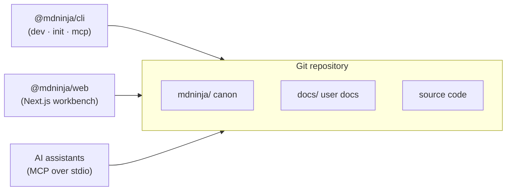
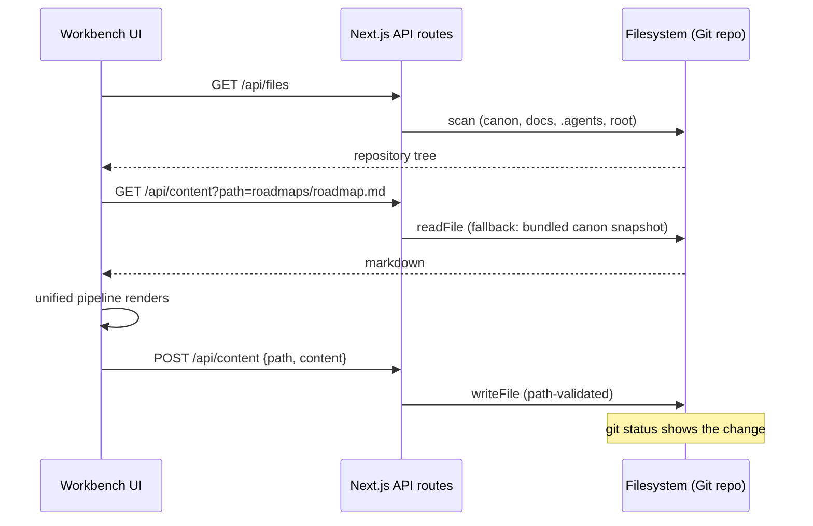

# Architecture Overview

How mdNinja is put together, and why each piece exists.

## 1. The Living Canon Principle

Git repositories are the source of truth. The operating model:

1. **Markdown on disk is the database.** ADRs, roadmaps, and diagrams are files under `mdninja/`; there is no parallel store to keep in sync.
2. **Edits are filesystem writes.** The workbench saves with `fs.writeFile`; Git status, diffs, and commits stay native.
3. **Agents operate through canon.** AI assistants read and write the same files through the MCP server, under the rules encoded in each ADR's `🤖 Agent Enforcement` section.
4. **Dual equal panels.** Split view gives two fully-capable panels; there is no primary/context panel distinction.



## 2. Monorepo Layout

| Path | Owns |
| :--- | :--- |
| `apps/web` | The workbench: Next.js 15 App Router frontend, filesystem API routes, and the canon bundler (`scripts/sync-canon.mjs`). |
| `apps/web/src-tauri` | Tauri 2 crate wrapping the same web frontend for native desktop. |
| `packages/cli` | `@mdninja/cli`: `dev` (static-server workbench launcher), `init` (scaffold), `mcp` (stdio MCP server). |
| `packages/canon` | `@mdninja/canon` — the single contract for `.mdninja/config.json` shape and the canonical `mdninja/` layout. Consumed by the CLI and the web scaffold route alike, so the two can never drift. |

The web app is one deployable; the CLI is one npm package; the canonical layout is one package. Three artifacts, one contract.

## 3. The AST Pipeline

Documents render through [unified](https://github.com/unifiedjs/unified):

```
remark-parse → remark-gfm → remark-math → remark-rehype → rehype-katex → rehype-highlight → rehype-stringify
```

* `remark-gfm` brings tables, task lists, strikethrough, and autolinks.
* `remark-math` + `rehype-katex` render `$inline$` and `$$block$$` LaTeX with zero layout shift.
* `rehype-highlight` colors fenced code blocks; the palette is fixed dark in both light and dark modes (see [troubleshooting](troubleshooting.md) for the rationale).

Mermaid fenced blocks are split out *before* the pipeline — they never pass through remark as code, they become `<MermaidViewer>` segments.

## 4. Diagram Engine

`MermaidViewer` renders intercepted `` ```mermaid `` blocks into SVG:

* **Standalone documents** (file is only a diagram) fill 100% panel height with a pan/zoom viewport (`react-zoom-pan-pinch`, 60fps) and an icon-only zoom cluster.
* **Embedded diagrams** render at natural aspect ratio inline with the text.
* **Theming is derived, never configured.** Every Mermaid `themeVariables` color resolves from the live CSS custom properties (`--bg-*`, `--text-*`, `--accent*`, `--border-*`) at render time; a `MutationObserver` on `<html>` re-renders on dark/light, reading-palette, or accent changes. There is no separate diagram theme (ADR 0010).
* Diagram surfaces are read-only; source edits go through the panel toolbar.

## 5. API Surface

| Route | Method | Purpose |
| :--- | :--- | :--- |
| `/api/files` | GET | Full repository scan: canon tree, `docs/`, `.agents/`, root Markdown, with document sizes. |
| `/api/content` | GET / POST | Read one document / write one document. Read falls back to the bundled canon snapshot when the file isn't on disk (serverless deployments). Writes are path-validated against the project root. |
| `/api/scaffold` | POST | Initialize the canon. Delegates to `@mdninja/canon` so CLI and web scaffolds are byte-identical. |
| `/api/auth/github` | GET | Start OAuth: binds a CSRF `state` to the browser via an `mdninja_oauth_state` httpOnly cookie, then redirects to GitHub. |
| `/api/auth/callback/github` | GET | Verify `state` against the cookie, exchange the code ephemerally, `postMessage` the account payload to the opener window, and retain nothing on the server (ADR 0004). |

## 6. Data Flow



## 7. Deployment Models

* **Local / CLI** — `mdninja dev` serves the workbench bound to the live filesystem; everything reads and writes the real repo.
* **Serverless (Vercel, production)** — root files live outside the function bundle root, so at build time `sync-canon` snapshots the canon into `apps/web/src/lib/canon-data.json` (and `public/schema.json` from `@mdninja/canon`). `/api/content` and `/api/files` fall back to that snapshot when the path isn't on disk (ADR 0005). Edits remain disk-backed on any filesystem-deploy host.
* **Desktop (Tauri 2)** — the Tauri crate loads the same build; `tauri dev` hot-reloads against the dev server, packaged builds load the static frontend (ADR 0008).

## 8. Multi-User Isolation

A public deployment like `mdninja.navinhill.com` serves everyone the same read surface; any visitor can then connect their own GitHub account:

* The OAuth exchange is **ephemeral** — tokens only ever transit the callback route in memory.
* Accounts, tokens, and repo lists persist **only in the visitor's browser `localStorage`.**
* The server stores nothing per-user: zero accounts, zero tokens, zero private-repo metadata (ADR 0004).

## 9. MCP & CLI

`@mdninja/cli` ships three entry points (full reference in [cli-reference.md](cli-reference.md)):

* `dev` — serve the visual workbench for any directory (`-p`, `-d`, `--no-open`).
* `init` — scaffold `.mdninja/config.json` + the canonical `mdninja/` layout via `@mdninja/canon`.
* `mcp` — stdio MCP server exposing `get_canon_structure`, `read_canon_doc`, `write_canon_doc`, `list_adrs`, `create_adr`, `get_roadmap`, `update_roadmap_task` (ADR 0007). The `create_adr` tool enforces sequential numbering and the `🤖 Agent Enforcement` section.

## 10. Decisions Index

| ADR | Subject |
| :--- | :--- |
| [0001](../mdninja/decisions/0001-monorepo-structure.md) | Monorepo structure |
| [0002](../mdninja/decisions/0002-zero-constraint-split-panel.md) | Zero-constraint split panels |
| [0003](../mdninja/decisions/0003-latex-katex-integration.md) | KaTeX math integration |
| [0004](../mdninja/decisions/0004-zero-leak-multi-user-isolation.md) | Zero-leak multi-user isolation |
| [0005](../mdninja/decisions/0005-bundled-canon-fallback.md) | Bundled canon fallback |
| [0006](../mdninja/decisions/0006-rebrand-and-dynamic-canon.md) | Rebrand + dynamic canon discovery |
| [0007](../mdninja/decisions/0007-mcp-server-and-cli-architecture.md) | MCP server & CLI architecture |
| [0008](../mdninja/decisions/0008-tauri-desktop-integration.md) | Tauri desktop integration |
| [0009](../mdninja/decisions/0009-ui-overhaul-and-github-oauth.md) | UI overhaul & GitHub OAuth |
| [0010](../mdninja/decisions/0010-diagram-theme-derivation-and-edit-consolidation.md) | Diagram theme derivation & edit consolidation |