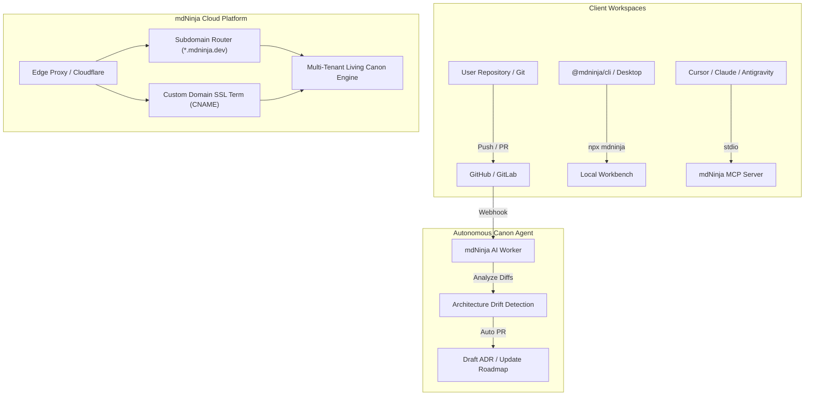

# Roadmap: Cloud Hosting, Custom Subdomains & Autonomous AI Agent

This document formalizes the architectural and product roadmap for the mdNinja Cloud platform, custom domain hosting, and autonomous repository maintenance agent.

## 1. Vision & Architecture

mdNinja transitions from a local living canon workbench to a full-lifecycle documentation, technical blog, and architectural canon platform.

---

## 2. Milestone Checklist

### Milestone 1: Multi-Tenant Cloud Architecture
- [ ] **Edge Routing & Tenancy Engine**:
  - Dynamically serve tenant canons based on Host header (`tenant.mdninja.dev`).
  - Edge caching with instant invalidation on git webhooks.
- [ ] **Repository Connector**:
  - Direct GitHub App integration for continuous synchronization of `mdninja/` and `docs/`.
  - Zero database dependency: Markdown files in the user's repository remain the single source of truth.

### Milestone 2: Custom Domains & Subdomains
- [ ] **Subdomain Provisioning**:
  - Instant allocation of `https://<org>.mdninja.dev` upon GitHub repository linking.
  - Reserved words validation, slug collision handling, and tenant isolation.
- [ ] **Custom Domain Routing**:
  - Point any custom domain (e.g. `docs.acme.com`) via CNAME to `cname.mdninja.dev`.
  - Automated Let's Encrypt SSL certificate provisioning and renewal via ACME protocol.

### Milestone 3: Autonomous Canon Keep-Up Agent
- [ ] **Commit & PR Drift Monitor**:
  - Background worker listening to GitHub push webhooks.
  - Detects significant architectural changes (e.g. new dependencies, schema alterations, major refactors).
- [ ] **Automated ADR & Roadmap Suggestions**:
  - Generates pull requests proposing new ADR drafts in `mdninja/decisions/` when architectural drift is detected.
  - Automatically checks off completed items in `mdninja/roadmaps/roadmap.md` when PRs merge.

### Milestone 4: Tiers, Monetization & Pro Workspaces
- [ ] **Free Tier**:
  - 100% free for open-source repositories and public canons.
  - Unlimited public viewers and fast edge caching.
- [ ] **Pro / Team Tier**:
  - Private repository living canons with team authentication.
  - Custom domain support with SSL.
  - Autonomous AI Canon Agent PR generations.
  - Reader analytics and search insights.

---

## 3. 🤖 Agent Enforcement
* **Living Canon Integrity:** Any cloud deployment must respect markdown as the authoritative source of truth. Cloud databases are strictly for caching, routing, and user session management.
* **No Vendor Lock-In:** A repository with `mdninja/` must always remain 100% functional locally via `npx @mdninja/cli` and offline via the Tauri desktop app, independent of cloud services.
