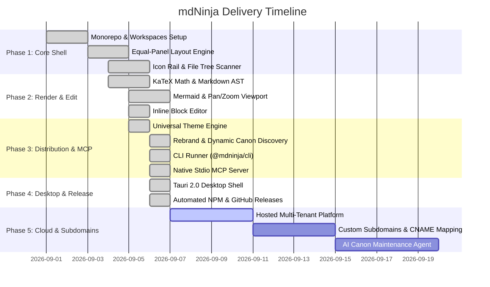

# mdNinja Living Roadmap

## 📊 Visual Execution Timeline

## 📋 Task Execution State

### Phase 1: Core Shell & Architecture
- [x] Establish monorepo structure with `apps/web` and `packages/cli`.
- [x] Configure `.mdninja/config.json` schema and living canon directories.
- [x] Build dual equal-panel layout with `react-resizable-panels`.
- [x] Implement collapsible icon rail and natural file tree scanner.

### Phase 2: Rendering & Block Editing
- [x] Implement Markdown AST pipeline with `remark-gfm`, `remark-math`, and `rehype-katex`.
- [x] Integrate Mermaid.js with `react-zoom-pan-pinch`, dynamic light/dark reactivity, and flip-to-edit toggle. *(flip-to-edit later removed in favor of single-source panel-toolbar editing — see [ADR 0010](../decisions/0010-diagram-theme-derivation-and-edit-consolidation.md))*
- [x] Build inline block editor, relative link interception, and local disk write API (`/api/content`).
- [x] Expand `docs/` into a full user-manual set (getting-started, user-guide, cli-reference, configuration-guide, architecture-overview, contributing, troubleshooting).

### Phase 3: Distribution, CLI Runner & MCP Protocol
- [x] Universal dark & light themes (Default, Tokyo Night, Nord Frost, GitHub Dimmed, Paper Sepia).
- [x] Rebrand to lowercase `mdninja` identifier with dynamic canon discovery (ADR 0006).
- [x] Standalone `@mdninja/cli` executable runner with `dev`, `init`, `build`, and `mcp` commands.
- [x] Out-of-the-box Model Context Protocol (MCP) server over `stdio` for AI assistants (Cursor, Claude, Windsurf, Antigravity) (ADR 0007).

### Phase 4: Desktop Application & Automated Release
- [x] Tauri 2.0 native desktop shell configuration (`apps/web/src-tauri`) with sub-20MB footprint and zero electron bloat (ADR 0008).
- [x] Automated GitHub Actions CI/CD release workflow (`.github/workflows/release.yml`) for publishing `@mdninja/cli` to NPM under `@mdninja` organization.
- [x] Bundled canon fallback for zero-latency serverless and offline rendering.

### Phase 5: Cloud Hosting, Custom Subdomains & AI Agent (Next)
- [ ] Multi-tenant living canon cloud hosting platform.
- [ ] Automated user subdomains (e.g. `https://<org>.mdninja.dev` or `.mdninja.com`).
- [ ] Custom domain mapping with automated SSL termination (CNAME routing).
- [ ] Autonomous AI Canon Agent to monitor Git commits, suggest ADRs, and synchronize roadmaps.
- [ ] Team subscription tiers, role-based access control (RBAC), and private repos.

---

## 🤖 Agent Context
* **Current Focus:** Provide seamless self-hosting, desktop native execution, and stdio MCP connectivity for all major AI coding assistants.
* **Definition of Done:** All tasks marked `[x]` must compile cleanly without TypeScript/Rust errors and verify successfully.
