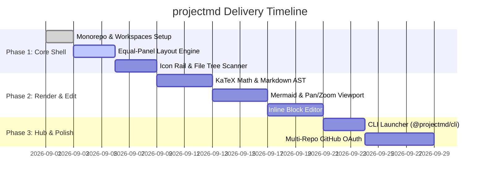

# projectmd Living Roadmap

## 📊 Visual Execution Timeline

## 📋 Task Execution State

### Phase 1: Core Shell & Architecture
- [x] Establish monorepo structure with `apps/web` and `packages/cli`.
- [x] Configure `.projectmd/config.json` schema and living canon directories.
- [x] Build dual equal-panel layout with `react-resizable-panels`.
- [x] Implement collapsible icon rail and natural file tree scanner.

### Phase 2: Rendering & Block Editing
- [x] Implement Markdown AST pipeline with `remark-gfm`, `remark-math`, and `rehype-katex`.
- [x] Integrate Mermaid.js with `react-zoom-pan-pinch` and flip-to-edit toggle.
- [x] Build inline block editor and local disk write API (`/api/content`).

### Phase 3: Distribution & CLI
- [ ] Implement `@projectmd/cli` runner script.
- [x] Validate dark/light themes and keyboard shortcuts (`Cmd+\`, `Cmd+B`, `Cmd+S`).
- [x] Multi-Repo GitHub OAuth integration and client-isolated account manager.

---

## 🤖 Agent Context
* **Current Focus:** Scaffold core Next.js 15 UI, design tokens, and AST rendering pipeline.
* **Definition of Done:** All tasks marked `[x]` must compile cleanly without TypeScript errors and render successfully in the browser.
