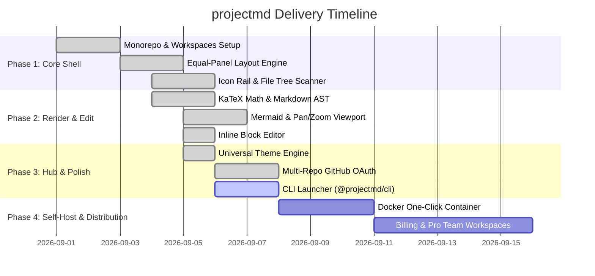

# projectmd Living Roadmap

## 📊 Visual Execution Timeline

## 📋 Task Execution State

### Phase 1: Core Shell & Architecture
- [x] Establish monorepo structure with `apps/web` and `packages/cli`.
- [x] Configure `.projectmd/config.json` schema and living canon directories.
- [x] Build dual equal-panel layout with `react-resizable-panels`.
- [x] Implement collapsible icon rail and natural file tree scanner.

### Phase 2: Rendering & Block Editing
- [x] Implement Markdown AST pipeline with `remark-gfm`, `remark-math`, and `rehype-katex`.
- [x] Integrate Mermaid.js with `react-zoom-pan-pinch` and flip-to-edit toggle.
- [x] Build inline block editor and local disk write API (`/api/content`).

### Phase 3: Distribution & Multi-Repo
- [x] Universal dark & light themes (Default, Tokyo Night, Nord Frost, GitHub Dimmed, Paper Sepia).
- [x] Multi-Repo GitHub OAuth integration and client-isolated account manager.
- [ ] Complete standalone `@projectmd/cli` executable runner (`npx mdninja`).

### Phase 4: Public Deployment & Self-Hosting
- [x] Public live deployment on `https://mdninja.navinhill.com` via Vercel with `@vercel/analytics`.
- [x] Fix 100% of upstream security advisories (`npm audit` -> 0 vulnerabilities).
- [x] Bundled canon fallback for zero-latency serverless rendering.
- [ ] One-click Docker container recipe for private air-gapped deployments.
- [ ] Optional team billing & organization workspace tiers.

---

## 🤖 Agent Context
* **Current Focus:** Provide seamless self-hosting and public live demo viewing of the real repository canon with zero mock data.
* **Definition of Done:** All tasks marked `[x]` must compile cleanly without TypeScript errors and render successfully in production.
