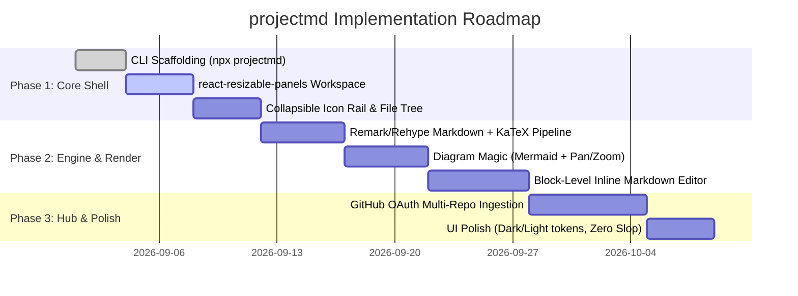

# projectmd — Product Specification & Architecture

**Version:** 1.0.0  
**Status:** Approved Architecture  
**Reference Date:** September 2026  
**Document Type:** Product Requirements & Architecture Blueprint

---

## 1. Executive Summary & Vision

**projectmd** is a high-fidelity, zero-constraint visual Markdown workbench and lens. It is built as a **"dumb app that reads and writes"**—fast, elegant, and completely unburdened by proprietary databases, vector queues, or complex AI daemon runtimes.

Modern development repositories are filled with Markdown:

- Human architecture docs, RFCs, and decision records (`docs/`, `decisions/`, `rfcs/`)
- AI agent instructions, tool skills, and working memory (`.agents/`, `AGENTS.md`, `memory.md`)
- Technical specs with math formulas and system diagrams (`diagrams/`, LaTeX equations)

**projectmd** provides an uncluttered, high-performance visual interface to view, edit, cross-reference, and diagram these files without imposing artificial workflows or file silos. The repository and the filesystem remain the sole source of truth.

---

## 2. Core Philosophy & Guiding Principles

1. **"A Dumb App That Reads and Writes"**
   - No black-box AI runtime, no vector databases, no background sync daemons.
   - If a Markdown file exists on disk, `projectmd` renders it. If you edit it, `projectmd` writes it back.
   - Agent memory is not a SaaS feature; it is simply a Markdown document (`memory.md`, `activeContext.md`) that `projectmd` renders, organizes, and edits with superior visual clarity.

2. **Zero Constraints — Never Artificially Limit the User**
   - No forced distinctions between "primary content" and "subordinate context."
   - Both panels are equal, flexible, and capable of holding any document or view.
   - Never block or stunt developer workflows through shallow foresight or prescriptive opinions.

3. **No Database Silos (Zero Drift)**
   - The filesystem and Git history *are* the database.
   - Edits are committed directly to disk locally or via standard Git APIs remotely.
   - Zero synchronization lag, zero data duplication.

4. **Zero Slop UI**
   - Typography-first, distraction-free environment.
   - No header bars eating vertical canvas.
   - No marketing fluff, greeting banners, or AI hype widgets.
   - Instant keyboard navigation and rapid rendering.

5. **Open Source Over Invention**
   - Standard, battle-tested libraries for all core primitives (`react-resizable-panels`, `Mermaid.js`, `Excalidraw`, `KaTeX`, `unified`/`remark`).
   - Absolutely no fragile handrolled parsers or custom diagramming engines.

---

## 3. User Decisions & Architectural Constants

| Architectural Area      | User Decision & Requirement                                                                           | Technical Implementation                                                                                                                                      |
| :---------------------- | :---------------------------------------------------------------------------------------------------- | :------------------------------------------------------------------------------------------------------------------------------------------------------------ |
| **Product Identity**    | Named **`projectmd`** (clean, direct, unpretentious).                                                 | Package names: `@projectmd/cli`, `@projectmd/core`.                                                                                                           |
| **Split-Panel Layout**  | **Two Equal Panels.** No "main vs context" constraint. One open by default; second toggled on demand. | Built on [`react-resizable-panels`](https://github.com/bvaughn/react-resizable-panels). Both panes have identical capabilities (render, edit, flip diagrams). |
| **Chrome & Canvas**     | **No Header Row.** Maximum vertical height. Collapsible icon rail/sidepanel.                          | Full-height canvas. Left rail holds project picker, natural file tree, search, settings, and profile. Collapsible to 0px width.                               |
| **LaTeX Support**       | Native inline (`$math$`) and display (`$$math$$`) math formula rendering.                             | `remark-math` + `rehype-katex`. Instant, zero-layout-shift mathematical typography.                                                                           |
| **Diagram Engine**      | Open, adaptable, interactive, themeable. **Zero handrolling.**                                        | Mermaid.js (`@mermaid-js/mermaid`) + Excalidraw (`@excalidraw/excalidraw`) wrapped in `react-zoom-pan-pinch` for smooth vector zoom and pan.                  |
| **Directory Discovery** | Native repo scanning. Surface existing `.agents/`, `docs/`, `.github/`, and root files.               | Scans standard directories automatically upon launch. Supports custom paths via `--paths`. Does not force files into a proprietary folder.                    |
| **Local Config (`.`)**  | Understand the technical role of dot (`.`) folders (hidden metadata vs visible content).              | Optional `.projectmd/` used solely for local UI state/preferences (pinned files, recent projects). Never stores actual Markdown content.                      |
| **Git Integration**     | Simple, predictable, un-overengineered.                                                               | Local: Direct `fs` writes to disk. Existing IDE/terminal handles Git. Optional simple "Commit" button in UI. Remote Hub: Standard GitHub REST/GraphQL API.    |

---

## 4. Repository Discovery & Information Architecture

### 4.1 How `projectmd` Discovers Files

When invoked inside a project (`npx projectmd`), the scanner inspects the project root:

```
[Project Root]
 ├── .agents/                 <-- Auto-detected: Agent instructions, skills, rules, memory
 ├── docs/ (or doc/, wiki/)   <-- Auto-detected: Human guides, ADRs, specs
 ├── .github/                 <-- Auto-detected: PR/issue templates, agent prompts
 ├── diagrams/                <-- Auto-detected: Architecture & schema files
 ├── README.md, CHANGELOG.md  <-- Auto-detected: Root Markdown files
 └── .projectmd/ (optional)   <-- Lightweight local UI preferences (pins, themes)
```

### 4.2 Custom Path CLI Flags

If a project uses custom directory conventions, flags pass them directly to the scanner:

```bash
# Point to custom documentation and agent directories
npx projectmd --paths ./specs,./architecture,.gemini/skills,./rfc
```

### 4.3 Understanding the Dot (`.`) Prefix

- **Filesystem convention:** Any folder prefixed with a `.` (e.g., `.agents`, `.github`, `.vscode`, `.projectmd`) is treated as hidden by Unix/POSIX and developer tools to keep project root directories uncluttered.
- **`projectmd` Handling:** Treats both hidden configuration folders (`.agents/`) and visible documentation folders (`docs/`) with equal first-class visibility in the sidepanel file tree.

---

## 5. UI & Workspace Architecture

```
+---+----------------------------+----------------------------+
| I | Equal Panel 1 (Default)    | Equal Panel 2 (On-Demand)  |
| C |                            |                            |
| O | - Open any Markdown doc    | - Open any Markdown doc    |
| N | - High-fidelity preview    | - Compare ADRs side-by-side|
|   | - Click-to-edit inline     | - Pin architecture diagram |
| R | - LaTeX math rendering     | - View agent memory        |
| A | - Interactive diagrams     | - Edit skills or specs     |
| I |                            |                            |
| L |                            |                            |
+---+----------------------------+----------------------------+
  ^
  |-- Collapsible: Project Picker, File Tree, Search, Settings
  |-- No Top Header Row: 100% vertical canvas dedicated to work
```

### 5.1 The Equal-Panel Engine

- **Library:** `react-resizable-panels`.

- **Behavior:**
  - **Default State:** Single full-width panel open.
  - **Dual State:** User clicks "Split" or presses `Cmd/Ctrl + \` to open a second equal panel.
  - **Zero Constraints:** Either panel can navigate anywhere in the file tree, switch between edit and preview, or host diagrams. Dragging the divider resizes the split fluidly.

### 5.2 The Collapsible Icon Rail & Sidepanel

- **Collapsed Mode:** Slender icon bar (24–36px) showing icons for File Explorer, Projects, Search, and Settings.

- **Expanded Mode:** Opens a clean, nested file tree representing the discovered directories.
- **Shortcut:** `Cmd/Ctrl + B` toggles the sidebar entirely, giving edge-to-edge reading and editing.

### 5.3 Inline Block Editing

- **Default Mode:** High-fidelity rendered Markdown view (beautiful typography, styled tables, rendered code blocks).

- **Block Activation:** Clicking any paragraph, header, list item, or code block instantly transforms that block into an active editor.
- **Saving:** Unfocusing or pressing `Cmd/Ctrl + S` commits changes directly to the file on disk.

---

## 6. Rendering Engine & Integrations

### 6.1 Markdown & Math Pipeline (AST)

- **Foundation:** Unified / Remark / Rehype pipeline.

- **Core Plugins:**
  - `remark-gfm`: GitHub Flavored Markdown (tables, task lists `[ ]`/`[x]`, strikethrough, autolinks).
  - `remark-math` + `rehype-katex`: Fast LaTeX mathematical formula parsing:
    - Inline math: `$f(x) = \sigma(W^T x + b)$`
    - Block math:
      $$\mathcal{L}_{total} = \mathcal{L}_{task} + \lambda \mathcal{L}_{reg}$$
  - `rehype-highlight` / `shiki`: Syntax highlighting across 100+ languages with dark/light themes.

### 6.2 Diagram Engine ("Diagram Magic" — Zero Handrolling)

- **Mermaid.js Integration:**
  - Code blocks tagged ````mermaid```` are intercepted by the renderer and converted to interactive vector SVGs.
  - Supports Gantt roadmaps, Git graphs, sequence diagrams, class diagrams, and C4 architecture models.

- **Excalidraw Integration:**
  - Native rendering and editing of `.excalidraw` or embedded Excalidraw JSON blocks for freeform architecture sketching.
- **Interactive Viewport (`react-zoom-pan-pinch`):**
  - Diagrams embed inside a responsive canvas supporting smooth mouse-wheel zooming, click-and-drag panning, and a 1-click "Reset Zoom" button.
- **Flip-to-Edit:**
  - Clicking an "Edit" icon on any rendered diagram flips the component to reveal the raw Markdown code block for immediate editing.

---

## 7. Deployment Models

### 7.1 Single-Instance Local Mode (CLI)

- **Invocation:** Run directly inside any repository:

  ```bash
  npx projectmd
  ```

- **Runtime:** Spawns a lightweight local Node.js server (Next.js/Vite) and opens the default browser.

- **File Operations:** Uses standard Node.js `fs/promises` (`readFile`, `writeFile`). Saves write directly to the local disk.
- **Git Behavior:** Leaves version control to the developer's normal environment. Provides an optional clean UI button to run `git commit -m "..."` for quick updates.

### 7.2 Standalone Hub Mode (Multi-Repo)

- **Runtime:** Centralized web application (self-hosted or hosted instance).

- **Authentication:** GitHub / GitLab OAuth.
- **Repository Mounting:** User selects repositories to mount into the `projectmd` project switcher.
- **File Operations:** Reads and writes directly via the GitHub Git Trees & Contents API. No heavy local git clones required on the server.

---

## 8. Technology Stack (September 2026 Standards)

| Layer                 | Selected Technology                             | Rationale                                                                       |
| :-------------------- | :---------------------------------------------- | :------------------------------------------------------------------------------ |
| **Framework**         | Next.js 15 (App Router) / React 19              | Standard, robust SSR/CSR rendering with instant Fast Refresh.                   |
| **Panel Management**  | `react-resizable-panels`                        | Battle-tested, accessible, zero-glitch resizable split panels.                  |
| **Markdown Parser**   | `unified`, `remark-parse`, `remark-gfm`         | Universal AST ecosystem with extensive plugin support.                          |
| **Math Renderer**     | `remark-math`, `rehype-katex`                   | Fastest LaTeX rendering engine; zero cumulative layout shifts.                  |
| **Code Highlighting** | `shiki`                                         | Token-accurate TextMate grammar highlighting with dual theme support.           |
| **Diagram Engine**    | `@mermaid-js/mermaid`, `@excalidraw/excalidraw` | Industry-standard declarative & sketch diagramming tools.                       |
| **Canvas Pan/Zoom**   | `react-zoom-pan-pinch`                          | Smooth 60fps hardware-accelerated vector manipulation.                          |
| **Styling**           | Vanilla CSS / CSS Modules                       | Complete control over typography, themes, and micro-interactions without bloat. |

---

## 9. Immediate Implementation Roadmap



### Phase 1: Core Shell & Navigation

- [x] Define canonical architecture and zero-constraint philosophy.
- [ ] Scaffold CLI runner package (`@projectmd/cli`).
- [ ] Implement equal-panel `react-resizable-panels` workspace with single/dual pane toggle.
- [ ] Build collapsible icon rail and natural repo file tree scanner (`.agents/`, `docs/`, root files).

### Phase 2: Rendering & Editing Pipeline

- [ ] Implement AST pipeline with `remark-gfm`, `remark-math`, and `rehype-katex`.
- [ ] Integrate Mermaid.js and Excalidraw with `react-zoom-pan-pinch`.
- [ ] Build click-to-edit inline block editor with direct disk write (`fs.writeFile`).

### Phase 3: Multi-Repo Hub & Refinement

- [ ] Implement GitHub OAuth and Trees API connector for multi-repo Hub mode.
- [ ] Fine-tune typography, themes (dark/light), and keyboard shortcuts (`Cmd+\`, `Cmd+B`, `Cmd+S`).
